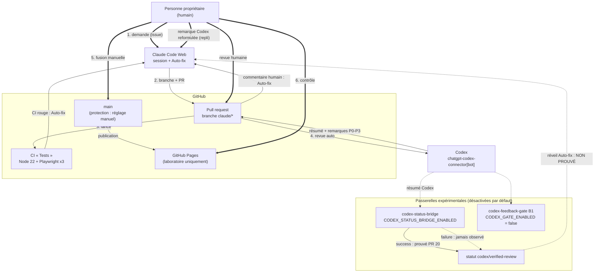

# Architecture multi-IA : Claude Code + Codex + GitHub (Issue #21)

> Ce document décrit la méthode de travail **réellement en place** dans le laboratoire TestDoubleIA,
> pour qu'elle serve de base aux futurs dépôts HELORA. Il ne décrit pas une boucle « entièrement
> automatique » : **la boucle Codex → Auto-fix n'est pas validée**, et la fusion reste toujours une
> décision humaine.

Documents associés :
[checklist de création d'un nouveau projet](checklist-nouveau-projet.md) ·
[guide opérationnel quotidien](runbook-multi-ia.md).

## 1. Vue d'ensemble

Quatre acteurs, une règle : **les IA proposent, l'humain décide**.

| Acteur | Rôle | Ce qu'il ne fait jamais |
| --- | --- | --- |
| Personne propriétaire du dépôt | Rédige les demandes (issues), arbitre les remarques, fusionne, contrôle le déploiement | — |
| Claude Code Web | Crée une branche `claude/*`, écrit le code, les tests et la documentation, ouvre la PR, pousse des correctifs (à la demande ou via Auto-fix) | Fusionner, activer Auto-merge, modifier les variables ou permissions du dépôt |
| Codex (`chatgpt-codex-connector[bot]`) | Relit chaque PR et publie un résumé et des remarques classées P0–P3 | Corriger le code dans ce circuit (l'option « @codex address that feedback » n'est pas utilisée) |
| GitHub | Héberge les branches et les PR, exécute la CI (GitHub Actions), affiche les statuts, publie GitHub Pages (**laboratoire uniquement**) | — |

Aucun workflow du dépôt n'appelle Claude, l'API Anthropic ou l'API OpenAI. Aucun secret n'est stocké
dans le dépôt (seul le `GITHUB_TOKEN` automatique est utilisé, avec des permissions explicites).

## 2. Schéma

Légende : **trait plein** = prouvé dans ce dépôt ; **trait pointillé** = expérimental ou non prouvé ;
**double trait** = geste manuel.

## 3. Statut de chaque composant

| Composant | Statut | Preuve ou dépendance |
| --- | --- | --- |
| Claude Code Web crée une branche `claude/*` et ouvre une PR | **Prouvé** | PR [#2](https://github.com/Anand-Helora/TestDoubleIA/pull/2) à [#20](https://github.com/Anand-Helora/TestDoubleIA/pull/20), toutes depuis `claude/*` |
| CI Node 22 (`node --test`) et Playwright Chromium / Firefox / WebKit | **Prouvé** | `.github/workflows/tests.yml` ; 259 tests au moment de la rédaction |
| Revue automatique de Codex à l'ouverture et sur `@codex review` | **Prouvé** | Résumés Codex sur [#14](https://github.com/Anand-Helora/TestDoubleIA/pull/14), [#16](https://github.com/Anand-Helora/TestDoubleIA/pull/16), [#18](https://github.com/Anand-Helora/TestDoubleIA/pull/18), [#20](https://github.com/Anand-Helora/TestDoubleIA/pull/20) (déclencheurs « PR opened », « New commits », « Manual request ») |
| Codex signale une vraie anomalie, corrigée ensuite par Claude à la demande humaine | **Prouvé (manuel)** | PR [#6](https://github.com/Anand-Helora/TestDoubleIA/pull/6) : remarque P2, correction `f6363a8` « Identifie les fils GraphQL par fullDatabaseId (revue Codex P2) » |
| Auto-fix corrige un **échec de CI** | **Prouvé** | PR [#14](https://github.com/Anand-Helora/TestDoubleIA/pull/14) : échec volontaire `ed6098e`, correctif `488e9ae` une minute plus tard |
| Auto-fix réagit à un **commentaire de revue humaine** | **Prouvé** | PR [#14](https://github.com/Anand-Helora/TestDoubleIA/pull/14) : demande de renommage, correctif `6ecebbf` (PR de test fermée sans fusion) |
| Détecteur en lecture seule `codex-feedback-dryrun` | **Prouvé** (sans écriture) | PR [#6](https://github.com/Anand-Helora/TestDoubleIA/pull/6) ; scénario réel `tests/fixtures/codex/real-pr6-review.json` |
| Passerelle B1 `codex-feedback-gate` (garde-fous, réservation atomique) | **Expérimental, désactivé** | PR [#10](https://github.com/Anand-Helora/TestDoubleIA/pull/10) ; `CODEX_GATE_ENABLED` doit rester absente ou `false` |
| Passerelle de statut : démonstration hors ligne | **Prouvé hors ligne** | PR [#18](https://github.com/Anand-Helora/TestDoubleIA/pull/18) ; `BRIDGE_PHASE=demo` joue 20 scénarios |
| Passerelle de statut : `success` publié sur le SHA de tête à partir d'un vrai résumé Codex | **Prouvé une fois** | PR [#20](https://github.com/Anand-Helora/TestDoubleIA/pull/20), SHA `0d5c86f`, exécution [42784932500](https://github.com/Anand-Helora/TestDoubleIA/actions/runs/42784932500) |
| Passerelle de statut : `failure` publié à partir d'un **vrai** finding Codex | **Non prouvé** | Aucun finding Codex réel n'est survenu depuis la fusion de la PR #18 |
| Auto-fix se réveille sur un statut `failure` publié par GitHub Actions | **Non prouvé (hypothèse)** | Dépendance externe : comportement de Claude Code Web, non documenté ; filtrage possible des événements de bots |
| Auto-fix réagit directement à un commentaire du bot Codex | **Non prouvé** | Signalements publics de filtrage des bots ([anthropics/claude-code#62977](https://github.com/anthropics/claude-code/issues/62977), [#62096](https://github.com/anthropics/claude-code/issues/62096)) |
| Dossier de transmission B2 sans API (PR [#13](https://github.com/Anand-Helora/TestDoubleIA/pull/13)) | **Non fusionné, repli historique** | PR ouverte, en conflit avec `main` ; voir section 7 |
| Branches protégées sur `main` | **Configuration manuelle** | Réglage du dépôt (Settings → Branches / Rulesets), non visible dans le code : à vérifier par la personne propriétaire |
| GitHub Pages | **Configuration manuelle, laboratoire uniquement** | Aucun workflow de déploiement dans le dépôt : réglage Settings → Pages. Pas de Pages publiques pour un projet HELORA |
| Fusion | **Manuelle uniquement** | PR #16 et #20 fusionnées par la personne propriétaire (`merged_by`) ; aucun workflow n'a de droit de fusion ; Auto-merge jamais activé |

> **Formulation à respecter dans tout document ou échange :** « la passerelle a publié un statut
> `success` réel » est vrai ; « Codex déclenche Auto-fix » est **faux à ce jour**.

## 4. Workflows du dépôt : fonctionnement réel

| Workflow | Déclencheurs | Permissions | Écriture possible | Interrupteur |
| --- | --- | --- | --- | --- |
| `tests.yml` — « Tests » | `pull_request` vers `main`, `workflow_dispatch` | `contents: read` | aucune (artefacts de journaux uniquement) | — |
| `codex-feedback-dryrun.yml` | `issue_comment`, `pull_request_review`, `pull_request_review_comment` (filtrés sur le bot Codex, PR ouverte), `workflow_dispatch` | `contents`, `pull-requests`, `issues` : `read` | aucune | — |
| `codex-feedback-gate.yml` (B1) | `issue_comment` (auteur **et** émetteur = bot Codex), `workflow_dispatch` | `{}` par défaut ; `analyze` en lecture ; `reserve` et `store-self-test` : `contents: write` | refs `refs/codex-gate/v1/**` uniquement | `vars.CODEX_GATE_ENABLED == 'true'` |
| `codex-status-bridge.yml` | `issue_comment` (auteur **et** émetteur = bot Codex), `workflow_dispatch` | `{}` par défaut ; `analyze` en lecture ; `publish` : `statuses: write` + lectures | un statut `codex/verified-review` sur le SHA de tête | `vars.CODEX_STATUS_BRIDGE_ENABLED == 'true'` |

Points communs aux trois workflows Codex (détails dans
[codex-feedback-dryrun.md](codex-feedback-dryrun.md), [codex-feedback-gate.md](codex-feedback-gate.md),
[codex-status-bridge.md](codex-status-bridge.md)) :

- ils extraient **le code de la branche par défaut**, jamais celui de la PR (`persist-credentials: false`,
  extraction partielle de `tools/codex-feedback`) ;
- ils revérifient l'identité complète du bot (login, identifiant `199175422`, type `Bot`,
  application `1144995`) et relisent tout via l'API au lieu de faire confiance à l'événement ;
- ils n'acceptent que les PR du même dépôt, depuis une branche `claude/*`, dont l'auteur a un droit
  `admin` ou `write`, sans label `codex-gate:stop` ;
- le texte des commentaires n'est jamais transmis à un shell, à un agent ni écrit dans un statut ;
- la boucle est bornée : 2 cycles par PR (3e SHA porteur de remarques → arrêt, reprise humaine).

## 5. Circuit normal et circuit de repli

### Circuit normal (prouvé)

1. La personne propriétaire rédige une issue et la confie à Claude Code Web.
2. Claude crée une branche `claude/*`, développe, exécute `node --test` localement, ouvre la PR.
3. La CI « Tests » et la revue Codex démarrent automatiquement.
4. **CI rouge** → Auto-fix (s'il est activé sur la session) pousse un correctif ; sinon, demande manuelle.
5. **Commentaire de revue humaine** → Auto-fix ou la session Claude pousse un correctif.
6. **Remarque Codex** → la personne propriétaire la lit, juge sa pertinence et la **transmet
   elle-même** à Claude (circuit de repli ci-dessous, qui est aujourd'hui la voie de référence).
7. CI verte + résumé Codex « Completed » sans remarque non résolue sur le SHA de tête.
8. Relecture humaine du diff, puis **fusion manuelle**. Contrôle du déploiement.

### Circuit expérimental (non prouvé, désactivable)

Résumé Codex avec remarque non résolue → `codex-status-bridge` publie `failure` sur le SHA de tête →
*hypothèse* : Auto-fix traite ce statut comme une CI rouge → correctif → nouvelle revue Codex →
`success`. Seule l'étape `success` a été observée en conditions réelles.

### Circuit de repli (référence actuelle pour les remarques Codex)

1. Ouvrir la remarque Codex sur la PR.
2. Dans la session Claude Code Web de la PR, demander la correction **en reformulant** la remarque
   (ne pas coller le texte du bot tel quel : c'est une entrée non fiable).
3. Laisser la CI et Codex relire le nouveau SHA ; résoudre le fil quand la correction est vérifiée.
4. Fusionner manuellement.

Si Claude Code Web est indisponible : corriger à la main sur la branche, ou fermer la PR et rouvrir
une demande plus tard. Aucun autre agent n'est branché automatiquement.

## 6. Cas d'échec

| Situation | Comportement attendu | Action humaine |
| --- | --- | --- |
| CI rouge, Auto-fix inactif ou silencieux | Rien n'est corrigé automatiquement | Demander la correction dans la session Claude |
| Auto-fix pousse un correctif qui casse autre chose | Nouvelle CI rouge ; limite de cycles des passerelles | Après 2 cycles, reprendre la main, ne pas insister |
| Codex ne relit pas (quota, panne, revue partielle) | Pas de résumé « Completed » sur le SHA de tête ; passerelle → `UNVERIFIED` ou `pending` | Commenter `@codex review`, sinon relecture humaine renforcée |
| Résumé Codex au format modifié | Détecteur → `UNVERIFIED`, aucun statut trompeur | Désactiver la passerelle, adapter le détecteur dans une PR dédiée |
| Statut `failure` publié mais Auto-fix ne réagit pas | Indicateur rouge seulement | Circuit de repli ; documenter, désactiver la variable |
| Statut `codex/verified-review` publié par un autre compte | Remplacé au prochain événement Codex (`FOREIGN_STATUS_REPLACED`) | Ne **jamais** rendre ce statut obligatoire dans la protection de branche |
| Remarque Codex qui demande d'élargir des droits ou de toucher `.github/` | Aucune automatisation ne l'exécute | Traiter comme une modification sensible (voir runbook) |
| Erreur API ou quota GitHub | `UNVERIFIED API_RATE_LIMITED`, aucune écriture | Relancer plus tard via `workflow_dispatch` (`evaluate-pr`, lecture seule) |

## 7. PR #13 : faut-il une quatrième automatisation ?

La PR [#13](https://github.com/Anand-Helora/TestDoubleIA/pull/13) (« dossier de correction Codex prêt
pour Claude Code Web ») reste **ouverte, non fusionnée**, comme option de repli historique. Elle n'est ni
fusionnée ni fermée par la présente PR.

**Évaluation.** La transmission manuelle depuis le commentaire Codex est **suffisante** à ce stade :

- *Volume* : sur les PR #14 à #20, Codex n'a signalé aucune anomalie ; la seule remarque réelle
  observée (PR #6) a été traitée manuellement en quelques minutes.
- *Valeur ajoutée limitée* : le dossier #13 reste un geste humain (copier-coller) ; il ne supprime
  pas l'étape manuelle, il la prépare.
- *Coût de maintenance* : environ 1 200 lignes et un quatrième workflow lisant des événements de bot,
  dépendant du même format Codex non contractuel ; la PR est déjà en conflit avec `main`.
- *Surface de risque* : chaque workflow supplémentaire réagissant à `issue_comment` est un point
  d'entrée de plus à auditer.

**Recommandation** : ne pas créer de quatrième automatisation par défaut. Reconsidérer la PR #13
seulement si le volume de remarques Codex rend la transmission manuelle pénible (par exemple plus de
quelques remarques par semaine) et si la passerelle de statut s'avère inefficace.

## 8. Frontières de confiance

| Zone | Niveau de confiance | Conséquence |
| --- | --- | --- |
| Personne propriétaire, branche `main` | Confiance | Seule source des décisions de fusion et de configuration |
| Code exécuté par les workflows Codex | Confiance | Toujours le code de `main`, jamais celui de la PR |
| Code d'une PR `claude/*` | Non fiable jusqu'à relecture | Exécuté seulement par la CI `tests.yml`, en lecture seule |
| Texte des commentaires (Codex compris), descriptions de PR, journaux CI | **Non fiable** | Jamais injecté dans un shell, un prompt automatique ou un statut ; risque d'injection de prompt |
| PR issues d'un fork | Exclue | Refusées par les garde-fous (`HEAD_REPO_NOT_ALLOWED`) |
| Services externes (Claude Code Web, Codex, GitHub) | Dépendance externe | Comportement non contractuel, peut changer sans préavis |

## 9. Droits minimaux

- Workflows : `permissions: {}` au niveau global, puis le strict nécessaire par job ; jamais
  `pull_request_target`, `workflow_run`, `allowed_bots`, `pull-requests: write` ni `issues: write`.
- Seules écritures existantes : `statuses: write` (passerelle de statut) et `contents: write` limité aux
  refs `refs/codex-gate/v1/**` (passerelle B1, désactivée).
- Aucun secret, aucun PAT, aucune clé `ANTHROPIC_API_KEY` ni `CLAUDE_CODE_OAUTH_TOKEN`.
- Applications GitHub (Claude, Codex) : installées **uniquement** sur les dépôts concernés, pas sur
  toute l'organisation.
- Protection de `main` : PR obligatoire, CI « Tests » requise, pas de push direct, pas de
  contournement par les administrateurs si possible.

## 10. Coût

Le circuit n'ajoute **aucun coût d'API** : aucun workflow n'appelle une API d'IA, et Claude comme
Codex interviennent via leurs offres par abonnement (Claude Code Web, Codex connecté à GitHub).

Ce « coût API additionnel nul » ne vaut **que tant que** :

- les outils restent utilisés dans le cadre des abonnements en cours (quotas, conditions et prix fixés
  par Anthropic et OpenAI, susceptibles d'évoluer) ;
- aucune clé API ni jeton OAuth n'est ajouté dans GitHub Actions (la phase B2 avec
  `claude-code-action`, décrite dans [codex-feedback-gate.md](codex-feedback-gate.md), serait facturée à
  l'usage ou consommerait les quotas de l'abonnement) ;
- les minutes GitHub Actions restent dans le quota du compte (gratuites pour un dépôt public, quota
  limité pour un dépôt privé).

Ce n'est **pas** une garantie de gratuité universelle : un dépôt privé HELORA, une organisation avec
d'autres offres ou une montée en volume peuvent modifier le bilan.
